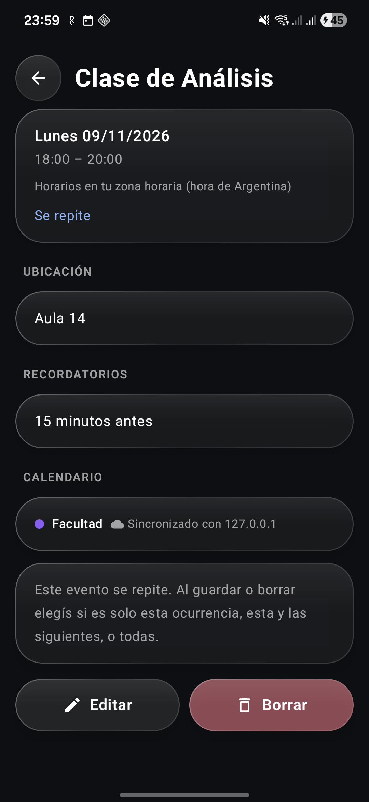
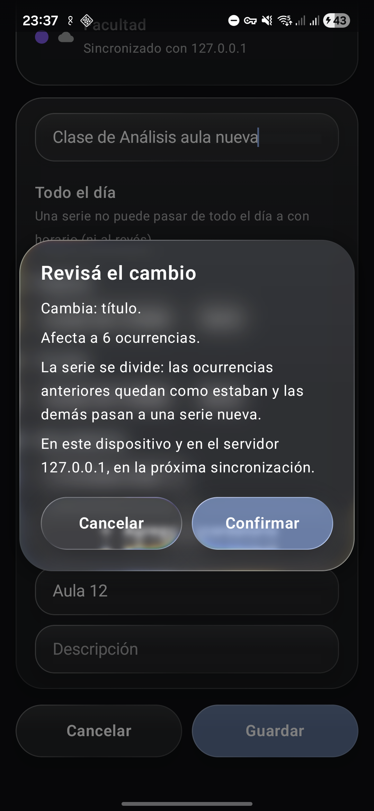
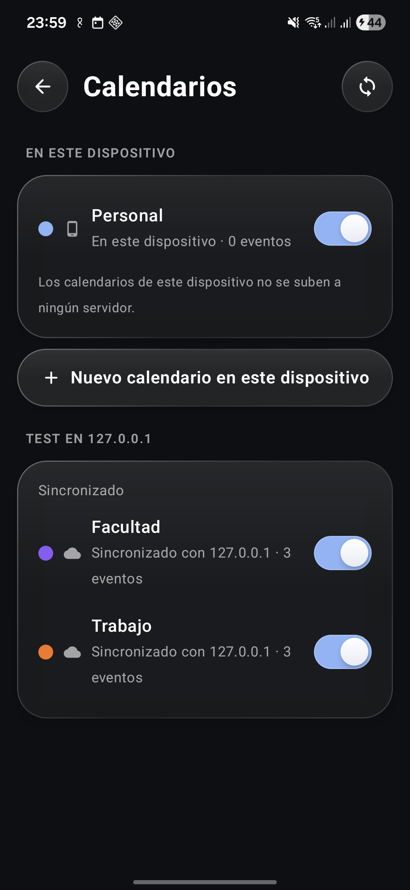
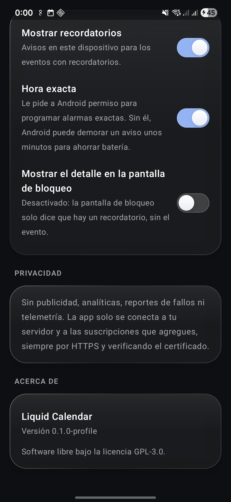

# Liquid Calendar

[English](README.md) | **Español**

Se instala en el celu como **Calendario** (o *Calendar*, según el idioma).

Calendario CalDAV libre para Android, pensado para un servidor propio como
[Radicale](https://radicale.org). Tiene la misma interfaz de cristal líquido que
[Liquid Clock](https://github.com/mrsalvaa/liquid-clock) y
[Liquid Gallery](https://github.com/mrsalvaa/liquid-gallery). Licencia GPL-3.0.

<p align="center">
  
  
  
  
</p>
<p align="center">
  
  
  
</p>

> En desarrollo: todavía no hay ninguna versión publicada. Las capturas son de datos de prueba
> (`scripts/demo-data.py`) en un Radicale local.

## Qué hace

- Vistas de mes, semana, día y agenda; en semana y día, pellizcar cambia la altura de las horas.
- Calendarios en el dispositivo (nunca se suben) y, opcional, una cuenta CalDAV.
- Crear, editar y borrar eventos; en una serie, solo esta, esta y las siguientes, o todas, con un
  resumen antes de confirmar.
- Recordatorios con notificaciones locales. Por defecto no muestran el evento con el celu bloqueado.
- Sin conexión: los cambios esperan en una cola y nunca pisan una versión más nueva del servidor.

Lo que todavía falta o funciona a medias está en [docs/LIMITACIONES.md](docs/LIMITACIONES.md).

## Privacidad

- Sin publicidad, analíticas, reportes de fallos ni telemetría, y sin Google Play Services.
- La app solo se conecta a tu servidor y a las suscripciones de calendario que agregues vos.
- Solo HTTPS, verificando el certificado como corresponde. `http://` va a requerir activarlo a
  propósito.
- No se hace copia de seguridad en la nube ni se pasan los datos a otro celu.

## Dependencias

Las versiones están fijadas en `gradle/libs.versions.toml`. Además de AndroidX/Compose y
[Backdrop](https://github.com/Kyant0/AndroidLiquidGlass) (como en las otras apps Liquid), `core` usa:

| Biblioteca | Versión | Licencia | Para qué |
|---|---|---|---|
| OkHttp + Okio | 5.3.2 / 3.16.4 | Apache-2.0 | HTTP con el servidor CalDAV |
| ical4j | 4.4.0 | BSD-3-Clause | Lectura de iCalendar y recurrencias |
| commons-lang3, commons-codec | 3.18.0, 1.17.0 | Apache-2.0 | las pide ical4j |
| threeten-extra | 1.8.0 | BSD-3-Clause | la pide ical4j |
| slf4j-api | 2.0.12 | MIT | la pide ical4j (sin backend: no registra nada) |

**OkHttp está fijado a propósito en la 5.3.2.** Desde la 5.4, su artefacto para Android exige
`compileSdk` 36 (la 5.5 pide 37), y el AGP 8.9.3 que comparten Liquid Clock y Liquid Gallery no
puede compilar contra esas versiones. Hay que pasar a un OkHttp más nuevo junto con la
actualización de AGP y `compileSdk`. Mientras tanto, **antes de cada release revisá que la 5.3.2 (y
Okio) no tengan vulnerabilidades conocidas**, por ejemplo en
[osv.dev](https://osv.dev/list?ecosystem=Maven&q=com.squareup.okhttp3) y en el
[registro de cambios](https://square.github.io/okhttp/changelogs/changelog/) de OkHttp.

ical4j nunca descarga zonas horarias: está desactivado en `ical4j.properties` y R8 elimina ese
código de la release.

## Compilar

```bash
JAVA_HOME=/usr/lib/jvm/java-17-openjdk ./gradlew assembleRelease
```

Tests y lint:

```bash
./gradlew :core:test :app:lintDebug
```

`core` es Kotlin puro, sin dependencias de Android (validación de la URL del servidor, borrado de
secretos en los logs y, más adelante, CalDAV e iCalendar), así que sus tests corren en la JVM.

Antes de cada commit, `scripts/check-secrets.sh` busca dominios, rutas personales, claves y
contraseñas en los archivos preparados. Los patrones personales van en `.secret-patterns`, que git
ignora.
