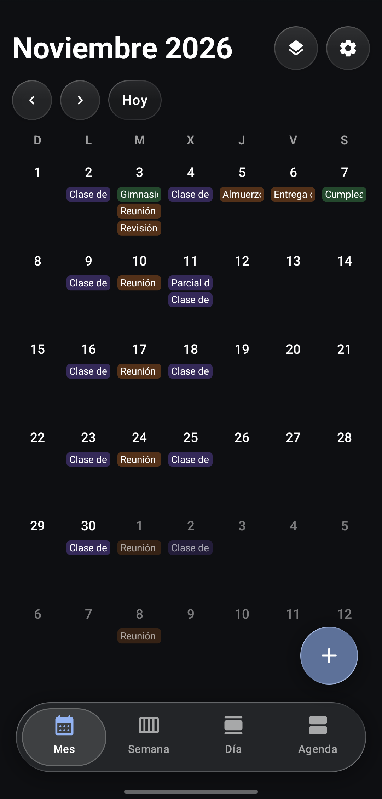
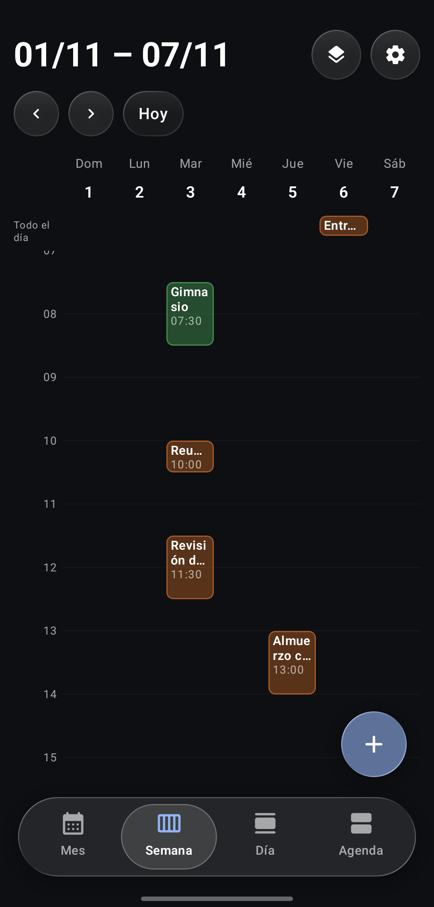
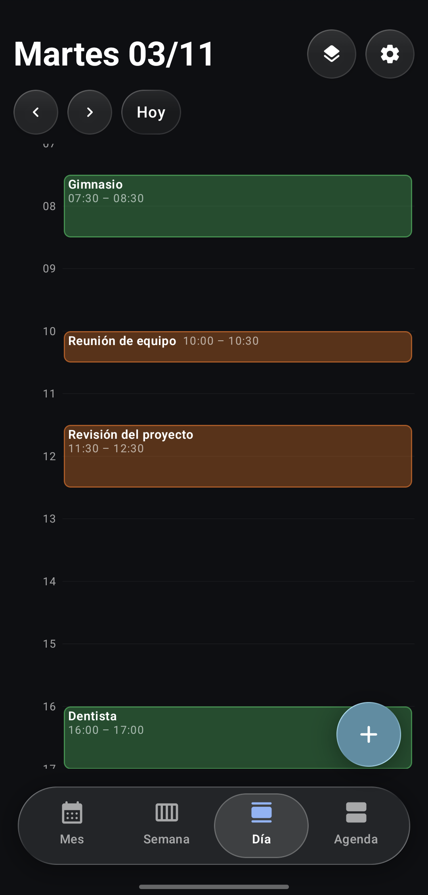
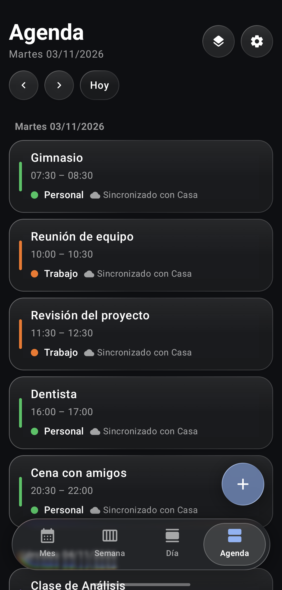
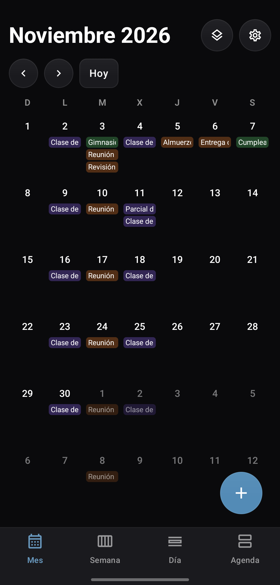
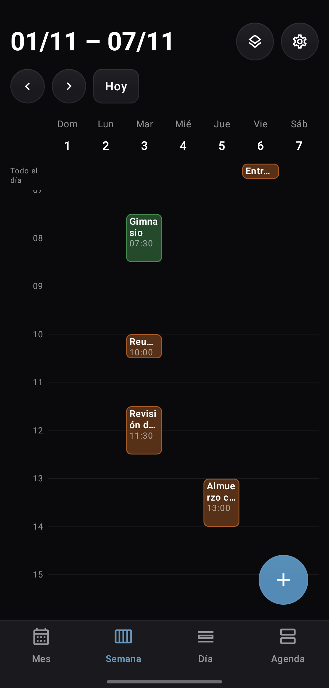
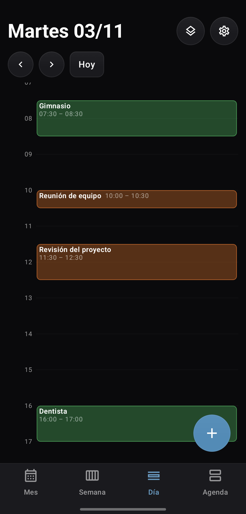
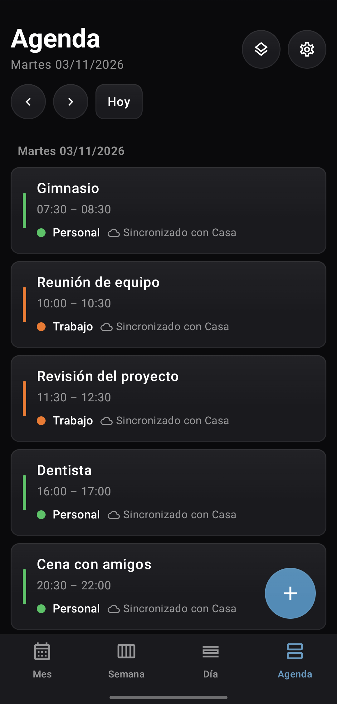

# Liquid Calendar

**English** | [Español](README.es.md)

Installs on the phone as **Calendar** (*Calendario* in Spanish).

A free CalDAV calendar for Android, made for a self-hosted server such as
[Radicale](https://radicale.org). Same liquid-glass interface as
[Liquid Clock](https://github.com/mrsalvaa/liquid-clock) and
[Liquid Gallery](https://github.com/mrsalvaa/liquid-gallery): surfaces that refract what's behind
them (thanks to [Backdrop](https://github.com/Kyant0/AndroidLiquidGlass)) and buttons that squish
like a droplet. If you'd rather have something plainer, Settings has a Solid style: opaque cards,
small corners and outline icons.

No ads, no telemetry and no Google services. It only talks to your server and to the
subscriptions you add yourself. Licensed under GPL-3.0.

<p align="center"><b>Liquid Glass</b></p>
<p align="center">
  
  
  
  
</p>
<p align="center"><b>Solid</b></p>
<p align="center">
  
  
  
  
</p>

Screenshots show made-up test data (`scripts/demo-data.py`) on a local Radicale.

## Features

**Views**: month, week, day and agenda. In week and day, pinch to change the height of the hours.
The first day of the week is configurable; dates are shown as day/month/year.

**Events**
- Create, edit and delete events, with all-day or timed events in any time zone.
- Series: change or delete just this one, this and the following ones, or all of them, with a
  summary of how many occurrences change before confirming.
- Reminders as local notifications. By default the lock screen shows only "Event reminder", not the title.

**Calendars**
- Calendars on the device (never uploaded) and an optional CalDAV account. Every calendar always
  shows where it lives: on this device, synced with a server, or a subscription.
- Create, rename, recolor and delete calendars on the server. Deleting asks you to type the
  calendar's name, shows how many events are lost and offers to export first.
- If a calendar disappears from the server, nothing is deleted: you choose to keep it on the
  device, export it or discard it.

**Agenda widget**: the events of today and the next 13 days on the home screen, grouped by day,
with the app's look (theme, background style and accent colour). Tap an event to open it, or
"+" to create one for today. It updates by itself after every change or sync.

**Sync**
- Works offline: changes wait in a queue and are uploaded later. Every upload is conditional
  (ETag), so it never overwrites a newer version; on a conflict you see both and choose.
- Background sync with WorkManager, configurable or manual only.

**Subscriptions and files**
- Read-only webcal/ICS subscriptions that stay on the device, refreshed every 1 h, 6 h, 12 h,
  day or week, or only by hand (12 h by default).
- Import `.ics` files with a preview and a choice of calendar. Export a calendar or a single event.

## Requirements

- Android 12 or newer.
- For sync: a CalDAV server over HTTPS with a certificate from a public authority (for example
  Let's Encrypt). Tested with Radicale 3.8. Without a server, calendars stay on the device.

## Download and install

See what changed in each version in the [changelog](CHANGELOG.md).

Get the APK from [Releases](../../releases) and install it.

Check that the file hasn't been tampered with:

```bash
sha256sum -c liquid-calendar-v1.2.0.apk.sha256
```

```
d7a2b5937ce2ac17f71fa3c1b2c2dbc816e2796b6fc1fa67ca69fcbc9097ad9b  liquid-calendar-v1.2.0.apk
```

And that it's signed with the project key (SHA-256 certificate fingerprint):

```
55:E9:13:E2:5A:F7:8B:01:1A:CD:1E:4E:16:83:E3:4C:EC:1D:60:05:91:0D:BE:94:08:8B:F0:1D:4B:0F:BC:05
```

```bash
apksigner verify --print-certs liquid-calendar-v1.2.0.apk
```

## Setting up the CalDAV server

In **Settings → Account**, enter:

- **Server address**: `https://` plus the host and port, for example
  `https://cal.example.org:8443/`. The app looks for your calendars by itself (it asks the
  address you give and then `/.well-known/caldav`). A full calendar or principal URL works too.
- **User** and **password**. Tap **Test connection** before saving.

Tips:

- Only `https://` is accepted, and the certificate must be valid for that name. Self-signed
  certificates and user-installed authorities are not accepted.
- Some servers (or a fail2ban in front of them) block your IP after a few wrong passwords. The app
  stops at the first `401` and never retries on its own, and it stops "Test connection" after
  3 wrong passwords in 10 minutes.
- A separate test user and calendar are a good idea the first time.

With Radicale, the server address is the root of the server (`https://host:port/`). Calendars
you create in the app are named with a random identifier on the server, so renaming them never
breaks sync.

## Security and privacy

**What it stores, and where.** Everything is in the app's private storage, which other apps
can't read:

| Data | Where | Protection |
|---|---|---|
| Events, calendars and pending changes | SQLite database `calendar.db` | Android app sandbox (not encrypted inside it) |
| Settings | `settings.json` | App sandbox |
| CalDAV password | `no_backup` folder | AES-256-GCM with a key kept in the Android Keystore (StrongBox if available), which can't be extracted |

Nothing is backed up to the cloud or copied to a new phone (`allowBackup="false"`).

**What it doesn't do**
- No ads, analytics, crash reporting or telemetry.
- No Google Play Services or any other Google service.
- No storage permissions: files are opened and saved only through the system file picker.
- No connections other than your server and the subscriptions you add.

**Connections**
- HTTPS only, verified against the system's certificate authorities. There's no certificate
  pinning (Let's Encrypt certificates change every few months), and no way to turn checks off.
- Redirects are followed only within the same server, never to plain `http`.
- **Wrong password (401)**: the first `401` stops every request, in the foreground and in the
  background, and the account waits until you type the password again.
- Busy server (`429`/`503`): the app waits as long as `Retry-After` says, or backs off.
- **Subscriptions** are downloaded without cookies, credentials or identifying headers, and with
  a generic User-Agent. Each download shows the feed's server your IP address; the app says so
  next to every subscription. If a feed moves to another server, the app asks before following it.

**Logs** contain only fixed event names and error types: never URLs (subscription ones
included), users, headers or event content.

**Exporting**: an `.ics` file is not encrypted. Anyone who gets the file can read those events;
the app warns you every time.

## Permissions

| Permission | What for |
|---|---|
| `INTERNET` | Talk to your CalDAV server and to your subscriptions. |
| `ACCESS_NETWORK_STATE` | Sync in the background only when there's a connection. |
| `WAKE_LOCK` | Keep the phone awake while a background sync runs (WorkManager). |
| `RECEIVE_BOOT_COMPLETED` | Reschedule reminders and background sync after a reboot. |
| `POST_NOTIFICATIONS` | Show reminders. Asked for the first time you add one. |
| `SCHEDULE_EXACT_ALARM` | Optional: reminders at the exact minute. You grant it in system settings; without it Android may delay them a few minutes. |

`DYNAMIC_RECEIVER_NOT_EXPORTED_PERMISSION` is added by AndroidX and is internal to the app.

## Dependencies

Versions are pinned in `gradle/libs.versions.toml`. All of them are compatible with GPL-3.0.

| Library | Version | License | What for |
|---|---|---|---|
| AndroidX (Core, Activity, Lifecycle, Compose BOM 2025.10.01, Material 3) | see `libs.versions.toml` | Apache-2.0 | Interface |
| AndroidX WorkManager (and Room, which it uses) | 2.10.5 | Apache-2.0 | Background sync |
| Kotlin stdlib, kotlinx-coroutines, kotlinx-serialization | 2.2.21, 1.8.1, 1.8.1 | Apache-2.0 | Language and settings file |
| Backdrop | 1.0.0 | Apache-2.0 | Liquid-glass effects |
| OkHttp + Okio | 5.3.2 / 3.16.4 | Apache-2.0 | HTTP to the CalDAV server and to subscriptions |
| ical4j | 4.4.0 | BSD-3-Clause | iCalendar parsing and recurrences |
| commons-lang3, commons-codec | 3.18.0, 1.17.0 | Apache-2.0 | Required by ical4j |
| threeten-extra | 1.8.0 | BSD-3-Clause | Required by ical4j |
| slf4j-api | 2.0.12 | MIT | Required by ical4j (no backend: logs nothing) |
| JetBrains annotations, JSpecify, ListenableFuture | 23.0.0, 1.0.0, 1.0 | Apache-2.0 | Annotations used by the above |

The full list with copyright notices is in [docs/THIRD-PARTY.md](docs/THIRD-PARTY.md).

**OkHttp is held at 5.3.2 on purpose.** From 5.4 on, its Android artifact requires
`compileSdk` 36 (5.5 requires 37), and AGP 8.9.3, shared with Liquid Clock and Liquid Gallery,
can't build against those. Move to a newer OkHttp together with the AGP/`compileSdk` upgrade.
Until then, **before every release check that 5.3.2 (and Okio) have no known vulnerabilities**,
for example on [osv.dev](https://osv.dev/list?ecosystem=Maven&q=com.squareup.okhttp3) and
OkHttp's [changelog](https://square.github.io/okhttp/changelogs/changelog/).

ical4j never downloads time zones: it's disabled in `ical4j.properties`, and R8 removes that code
from the release build.

## Known limitations

- Tasks (VTODO) aren't shown or edited.
- Subscriptions to feeds that need a user and password aren't supported.
- Importing never overwrites an event that already exists (same UID): it's skipped.
- An event can't be moved to another calendar.
- Only one CalDAV account.
- The in-app interface is in English and Spanish.

The full, up-to-date list (in Spanish) is in [docs/LIMITACIONES.md](docs/LIMITACIONES.md).

## Build

Requirements: JDK 17 and the Android SDK (platform 35 and build-tools).

```bash
echo "sdk.dir=/opt/android-sdk" > local.properties
JAVA_HOME=/usr/lib/jvm/java-17-openjdk ./gradlew assembleRelease
```

`assembleRelease` produces a minified APK. It's signed with the key described in
`~/.android-keys/liquid-calendar.properties` (or the path given by `-PsigningProps=...` or the
`LIQUID_CALENDAR_SIGNING` environment variable); if that file doesn't exist, the debug key is
used. The key and its passwords never go in the repository:

```properties
storeFile=/path/to/key.jks
storePassword=...
keyAlias=...
keyPassword=...
```

The debug build installs as `dev.liquidcalendar.debug`, next to the release. Only debug and
`profile` builds accept plain `http` to the phone itself (127.0.0.1), to test against a local
Radicale forwarded with `adb reverse`; the release never does.

Tests and lint:

```bash
./gradlew :core:test :app:lintDebug
scripts/radicale-test.sh start && ./gradlew :core:integrationTest   # local Radicale with uv
```

`core` is plain Kotlin with no Android dependencies (URL checks, CalDAV, iCalendar, sync queue),
so its tests run on the JVM.

Before each commit, `scripts/check-secrets.sh` looks for domains, home paths, keys and passwords
in the staged files (`--history` checks every commit). Personal patterns go in
`.secret-patterns`, which git ignores.

## Project structure

```
core/src/main/kotlin/dev/liquidcalendar/core/
├── dav/        CalDAV/WebDAV client and safe XML parsing
├── ics/        iCalendar reading and writing, series, time zones, import/export
├── feed/       webcal/ICS subscriptions
└── sync/       Change queue, retries, login guard
app/src/main/java/dev/liquidcalendar/
├── data/       SQLite cache, settings, Keystore-encrypted password
├── sync/       Sync engine, WorkManager, calendar operations, subscriptions
├── notify/     Reminders
├── widget/     Agenda widget
├── ui/glass/   Liquid-glass components
└── ui/screens/ Screens
```

## License

[GPL-3.0](LICENSE)
